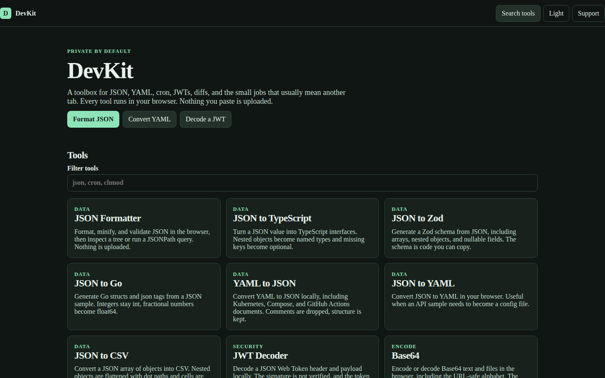
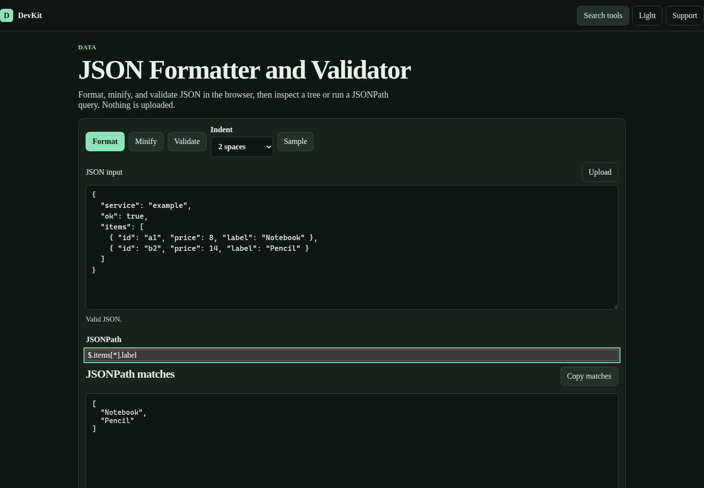
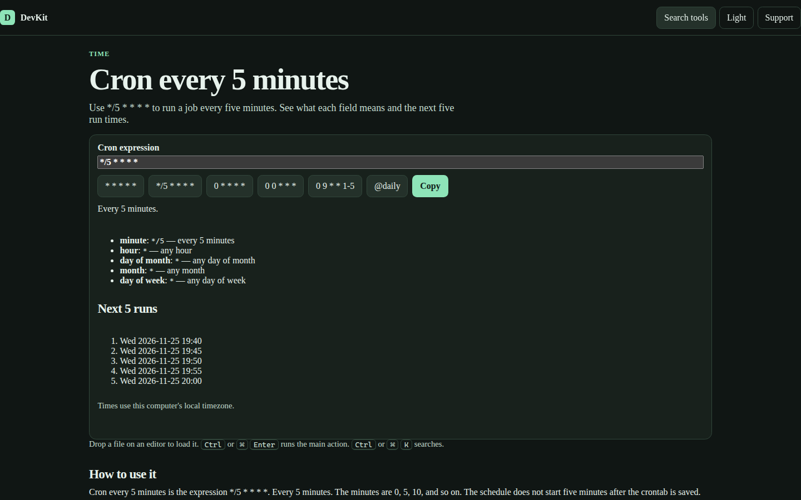
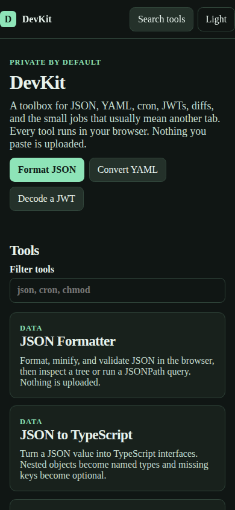
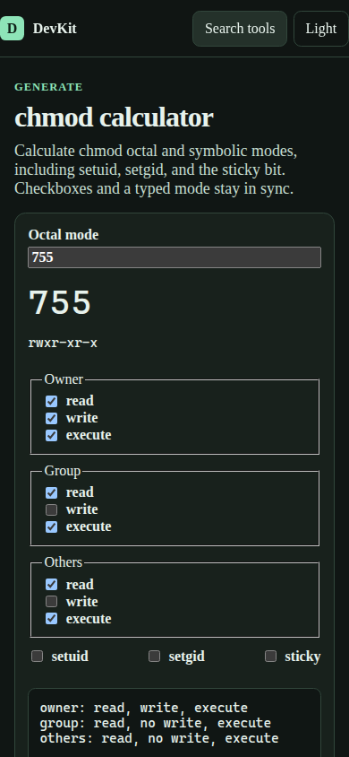

# DevKit

Private developer tools that run in the browser. Format JSON, convert YAML, decode a JWT, test a regex, explain a cron expression, and use the rest of the toolbox without uploading the text you paste.

The site is a static Next.js export. It deploys to GitHub Pages or Vercel, and a service worker makes pages you have opened available offline.











## Tools

Each tool has its own URL, a how-to, questions with FAQ structured data, and links to related tools.

- `/json-formatter/` formats, minifies, validates, and shows a tree and JSONPath. `/json-formatter/jsonpath/` opens on a query.
- `/json-to-typescript/`, `/json-to-zod/`, `/json-to-go/`, `/json-to-csv/`
- `/yaml-to-json/` and `/json-to-yaml/`, with `/yaml-to-json/kubernetes/`, `/docker-compose/`, `/github-actions/`, and `/helm/`
- `/jwt-decoder/` decodes only, shows an expiry countdown, and does not send the token anywhere
- `/base64/`, `/base64/encode/`, and `/base64/decode/` for text and files
- `/url-encode/`
- `/regex-tester/` with a token explanation and a cheat sheet
- `/cron/`, including `/cron/every-5-minutes/` and the other common expressions
- `/unix-timestamp/`
- `/uuid-generator/` for UUID v4, ULID, and NanoID
- `/hash-generator/`, `/hash-generator/sha256/`, and `/hash-generator/sha512/`
- `/diff-checker/` side by side and inline
- `/sql-formatter/`
- `/curl-to-code/` for fetch, axios, Python requests, and Go
- `/chmod-calculator/`
- `/minify/` for HTML, CSS, and JavaScript
- `/markdown-preview/` prints to PDF through the browser
- `/color-converter/` for colour conversion and WCAG contrast
- `/gitignore-generator/` and `/readme-generator/`

Search with Ctrl or ⌘ K. Drop a file on an editor. The current input is kept in the URL hash so a link can reopen it, and recent snapshots stay in local storage until you clear them. Dark mode is the default.

## Develop

```bash
npm ci
npm test
npm run dev
```

`npm run build` writes Open Graph images, exports the site to `out/`, and adds the service worker. `npm run test:e2e` serves that folder and runs the Playwright smoke tests.

Copy `.env.example` if you need a canonical origin:

```bash
NEXT_PUBLIC_SITE_URL=https://example.com
NEXT_PUBLIC_BASE_PATH=
```

`NEXT_PUBLIC_BASE_PATH` is for a GitHub project site such as `/devkit`. Leave it empty on Vercel or a domain root.

## Deploy

GitHub Actions in `.github/workflows/ci.yml` typechecks, runs unit tests, builds, and runs the smoke tests. `.github/workflows/pages.yml` publishes `out/` to GitHub Pages for the `main` branch. The Pages build defaults to `https://<owner>.github.io/<repo>` and a base path of `/<repo>`. Set the repository variables `NEXT_PUBLIC_SITE_URL` and `NEXT_PUBLIC_BASE_PATH` when that default is wrong.

Vercel can import the repo as a Next.js project. `output: "export"` is already set. Set `NEXT_PUBLIC_SITE_URL` to the production origin and leave the base path empty.

Ads and analytics are off unless you opt in at build time:

```bash
NEXT_PUBLIC_ADS_ENABLED=true
NEXT_PUBLIC_CARBON_SERVE=your-serve-id
NEXT_PUBLIC_CARBON_PLACEMENT=your-placement
NEXT_PUBLIC_PLAUSIBLE=true
NEXT_PUBLIC_PLAUSIBLE_DOMAIN=example.com
NEXT_PUBLIC_SPONSOR_URL=https://example.com/sponsor
```

The ad slot is one component. It renders nothing when the flag is off. Plausible is the only analytics hook, and it is not injected by default. There is no other tracker.

## Privacy

Parsing happens in the page. History and the theme live in `localStorage`. A share link puts the input in the URL hash, which is not sent as the request path, but anyone with the link can read it. Do not put secrets in a link you send on.

## SEO

The keyword map, the rules for adding another guide, and the ideas that are worth a page later are in [docs/SEO.md](docs/SEO.md).

## Design tokens

Colours, type, radius, and borders are CSS custom properties with the usual semantic names: `--background`, `--foreground`, `--primary`, `--muted`, `--border`, `--ring`, `--radius`. [sutra-ui](https://github.com/AkhilSingh2/sutra-ui) does not publish a token file yet. When it does, override these properties.

## License

MIT.
